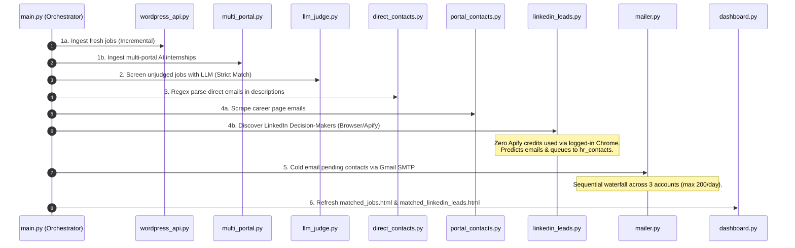

# Project Master Context & Architecture Handover
**System Name:** Autonomous Job Intelligence, LinkedIn Decision-Maker Discovery & Cold Outreach Agent  
**Candidate:** Sparsh Goyal (B.Sc Computer Science, Hansraj College, University of Delhi, Class of 2026)  
**Root Workspace:** `c:\Users\hp\OneDrive\Desktop\medicine_app`  
**Primary Database:** `jobviareferral.db` (SQLite)  
**Target Roles:** AI/ML Engineer Intern, Python Developer Intern, Backend Engineer Intern, Software Development Engineer Intern (SDE)

---

## 1. Candidate Background & Profile Configuration

All candidate details used by LLMs, browser appliers, and email generators are stored in `candidate_profile.json`:

* **Full Name:** Sparsh Goyal
* **Email:** `sparshgoyal199@gmail.com`
* **Education:** B.Sc. (Hons) Computer Science, Hansraj College, University of Delhi (2023 – 2026), CGPA: 8.15
* **Target Role:** AI / Python / Backend Engineer Intern
* **Core Technical Skills:** Python, FastAPI, RAG (Retrieval-Augmented Generation), LangChain, MCP (Model Context Protocol) Server, LLM Orchestration, SQLite, Vector Databases, Playwright, Git
* **Flagship Projects:**
  1. **KhojAI:** Collaborative RAG platform that reduced retrieval memory usage by 4× using optimized vector chunks and LangChain.
  2. **DhanTrackAI:** Production-grade MCP server featuring OAuth 2.1 authorization and conversational expense management.
* **Portfolio & Social Links:**
  * **GitHub:** `https://github.com/sparshgoyal199`
  * **LinkedIn:** `https://linkedin.com/in/sparshgoyal199`
  * **Resume (Google Drive):** `https://drive.google.com/file/d/1-wrlSqEKe1gXYI0X8Zc7wkpz_lhsCH5H/view?usp=sharing`
  * **Master Resume PDF:** `C:\Users\hp\OneDrive\Desktop\Resume\sparsh_goyal_resume.pdf` (Automatically attached as `Sparsh_Goyal_Resume.pdf` to all cold emails)
  * **Local Workspace Copy:** `c:\Users\hp\OneDrive\Desktop\medicine_app\resume.pdf`

---

## 2. System Architecture & Directory Tree

```text
medicine_app/
├── main.py                             # Master pipeline orchestrator & unified CLI
├── candidate_profile.json              # Source of truth for candidate credentials & skills
├── resume.pdf                          # Candidate PDF resume for Playwright uploads
├── jobviareferral.db                   # Central SQLite database
├── chrome_profile/                     # Persistent real Chrome user data (saved logins & cookies)
├── .env                                # API tokens (Gemini, Apify, Gmail App Passwords)
│
├── src/
│   ├── ingestion/
│   │   ├── wordpress_api.py            # REST API incremental ingestion from JobViaReferral
│   │   └── multi_portal.py             # Playwright multi-portal scraper (LinkedIn, Indeed, Internshala)
│   │
│   ├── evaluation/
│   │   └── llm_judge.py                # Gemini 1.5/2.0 Flash Strict Binary Resume Fit Evaluator
│   │
│   ├── enrichment/
│   │   ├── direct_contacts.py          # Regex scraper for HR emails in raw job descriptions
│   │   ├── portal_contacts.py          # 4-step free waterfall scraper for company careers pages
│   │   ├── linkedin_leads.py           # Free browser-first LinkedIn discovery + corporate email predictor
│   │   └── linkedin_decision_makers.py # Legacy fallback decision-maker scraper
│   │
│   ├── outreach/
│   │   └── mailer.py                   # Gmail SMTP cold email sender with 3-account sequential waterfall
│   │
│   ├── copilot/
│   │   └── applier.py                  # Playwright autonomous browser application agent
│   │
│   └── reporting/
│       └── dashboard.py                # Generates matched_jobs.html and opens the interactive UI
│
├── matched_jobs.html                   # HTML Dashboard of all matched jobs & application states
├── matched_jobs.csv                    # CSV export of all matched jobs
├── matched_linkedin_leads.html         # Interactive UI for LinkedIn profiles, 1-click copy note & email
└── matched_linkedin_leads.csv          # CSV export of discovered decision-makers
```

---

## 3. Database Architecture (`jobviareferral.db`)

The database uses SQLite with 4 primary tables:

### A. `details` (Job Postings Repository)
Stores raw and normalized postings from all portals.
* `post_id` (INTEGER PRIMARY KEY): Unique identifier.
* `title` (TEXT): Job title and role name.
* `url` (TEXT): Original source post URL.
* `apply_url` (TEXT): Direct company ATS / application URL.
* `description_text` (TEXT): Full text description of the job posting.
* `structured_fields` (JSON/TEXT): Stores `{"Company": "...", "Portal": "...", "Location": "..."}`.
* `verdict` (TEXT): LLM evaluation result (`'yes'`, `'no'`, or `NULL` if pending).
* `verdict_rationale` (TEXT): LLM explanation for the match/rejection.
* `fetch_status` (TEXT): `'ok'` or `'error'`.
* `enrich_status` (TEXT): `'found'`, `'not_found'`, or `NULL`.

### B. `hr_contacts` (Cold Outreach Queue)
Central queue read by `src/outreach/mailer.py`.
* `id` (INTEGER PRIMARY KEY AUTOINCREMENT)
* `post_id` (INTEGER): Associated post ID.
* `job_title` (TEXT): Candidate role or decision-maker headline.
* `company` (TEXT): Company name.
* `job_url` (TEXT): Stores the **direct LinkedIn profile URL** of the recruiter or job link.
* `hr_email` (TEXT): Corporate or direct HR email address.
* `hr_name` (TEXT): Clean full name of the recipient.
* `mail_status` (TEXT): `'pending'`, `'sent'`, `'failed'`, or `'skipped'`.
* `mailed_at` (TEXT): ISO 8601 timestamp of delivery.
* `error_msg` (TEXT): Any delivery error or bounce reason.
* `sender_email` (TEXT): Which Gmail account sent the email.

### C. `linkedin_leads` (Decision-Maker & Tech Leader Intelligence)
Stores discovered profiles, headlines, connection notes, and verified emails.
* `id` (INTEGER PRIMARY KEY AUTOINCREMENT)
* `post_id` (INTEGER): Job post reference.
* `company_name` (TEXT): Target company.
* `job_title` (TEXT): Role Sparsh is targeting.
* `person_name` (TEXT): Name of decision-maker.
* `headline` (TEXT): Current professional headline on LinkedIn.
* `linkedin_url` (TEXT UNIQUE): Direct profile link (`https://www.linkedin.com/in/...`).
* `category` (TEXT): `'HR & Talent Acquisition'` or `'Tech Leadership & Engineering'`.
* `connection_note` (TEXT): Custom tailored 300-character LinkedIn invite note.
* `source` (TEXT): `'browser_search'` (free) or `'apify_memo23'`.
* `discovered_at` (TEXT): Timestamp.
* `email` (TEXT): Predicted corporate email (`first.last@domain`).
* `domain` (TEXT): Official company domain with verified DNS MX.

### D. `portal_applications` (Autonomous Application Tracking)
Records the status of Playwright co-pilot form submissions.
* `id` (INTEGER PRIMARY KEY AUTOINCREMENT)
* `post_id` (INTEGER)
* `company` (TEXT)
* `job_title` (TEXT)
* `portal` (TEXT): Indeed, LinkedIn, Internshala, Career Page, etc.
* `status` (TEXT): `'submitted'`, `'review_needed'`, `'failed'`, `'captcha_blocked'`.
* `fields_filled` (INTEGER): Number of detected form fields automatically populated.
* `applied_at` (TEXT): Timestamp.

---

## 4. End-to-End Pipeline Execution Flow

When running:
```bash
uv run python main.py --enrich-linkedin --send-emails
```



---

## 5. Detailed Component Specifications

### 5.1 LLM Strict Resume Fit Evaluator (`src/evaluation/llm_judge.py`)
* **Model:** Google Gemini (`gemini-2.5-flash` via `google-genai` SDK).
* **Strict Evaluation Rule:** Compares job requirements against Sparsh Goyal's exact credentials.
  * **Pass Criteria (`YES`):** Roles specifically demanding Python, AI/ML, LLM workflows, RAG, Backend/Full-Stack development, or general SDE internships open to 2026 CS undergraduates.
  * **Fail Criteria (`NO`):** Senior roles requiring 3+ years experience, non-tech sales, finance, telecalling, graphic design, mechanical/civil engineering.

### 5.2 LinkedIn Decision-Maker Engine (`src/enrichment/linkedin_leads.py`)
* **Skill-Matched Company Selection:** Before touching a company, checks `is_role_relevant_for_candidate` and `evaluate_job_resume_fit`.
* **Dual Discovery Engine (Waterfall):**
  1. **Browser Search (100% Free, Zero Apify Credits):** Launches Playwright with `chrome_profile`. Queries LinkedIn People directly using boolean filters (`"<Company>" ("HR" OR "Recruiter" OR "Talent" OR "CTO" OR "Engineering")`). Discovers 8–15 profiles in ~10 seconds.
  2. **Apify Fallback:** If and only if browser search yields fewer than 2 candidates, activates Apify actor `memo23~linkedin-company-people-scraper`. Automatically rotates across 6 free token keys configured in `.env` ($30 free credits total).
* **Personalized Connection Notes:** Generates custom invite notes (< 300 characters, within LinkedIn's limit):
  * *For HR:* Mentions the specific role and Sparsh's Python/RAG/AI agent background.
  * *For Tech Leaders:* Highlights KhojAI & DhanTrackAI and expresses interest in engineering updates.
* **Corporate Email Prediction & MX Validation:**
  * Resolves official company domain from `apply_url` or web query.
  * Validates mail exchange using DNS MX (`dns.resolver.resolve(domain, 'MX')`).
  * Predicts statistical standard `first.last@domain` or `first@domain`.
  * Automatically inserts into `hr_contacts` with `mail_status='pending'` and `job_url` set to the person's LinkedIn profile.

### 5.3 Cold Email Sender (`src/outreach/mailer.py`)
* **Sequential Waterfall Strategy:**
  * **Account 1 (`sparshgoyal199@gmail.com`):** Handles primary delivery up to daily quota.
  * **Account 2 (`GMAIL_USER_2`):** Automatically overflows when Account 1 reaches quota.
  * **Account 3 (`GMAIL_USER_3`):** Third-tier overflow.
* **Safety & Deliverability:**
  * Hard safety cap of **200 emails/day** across all accounts to maintain sender reputation.
  * Deduplication: Never emails the same recruiter twice (`historically_sent` filter).
  * Domain Blacklist: Skips portal domains (`indeed.com`, `naukri.com`, `linkedin.com`).
* **Content:** Clean, high-converting HTML + Plaintext pitch highlighting Hansraj College CS background, 4× retrieval optimization in KhojAI, DhanTrackAI MCP server, with direct Google Drive resume link and GitHub profile.

### 5.4 Playwright Co-Pilot Job Applier (`src/copilot/applier.py`)
* **Profile:** Uses `chrome_profile/` so user login sessions (LinkedIn, Indeed, Google) persist without re-authenticating.
* **Stealth:** Leverages `playwright_stealth` and real Chrome browser binary (`C:\Program Files\Google\Chrome\Application\chrome.exe`).
* **Auto-Filling:**
  * Detects standard ATS inputs (Name, Email, Phone, LinkedIn, GitHub, College, Graduation Year).
  * Automatically uploads `resume.pdf`.
  * Uses LLM to draft answers for open-ended screening questions ("Why are you a good fit?", "Notice period", etc.).
* **Obstacle Handling:** If a platform presents Cloudflare Turnstile, phone SMS OTP, or multi-step external redirects (e.g. Indeed redirecting to Workday), it switches to **CO-PILOT REVIEW MODE**, leaving the browser open for manual user completion while recording the status.

---

## 6. The "Two Outreach Pools" Design (Important Distinction)

A critical architectural distinction in the system:
1. **LinkedIn Discovery & Co-Pilot Application Pool (Strictly Tech/Resume Fit):**
   * Uses LLM verification.
   * **Only** companies hiring for Python, AI/ML, Full-Stack, and SDE roles matching Sparsh's resume are targeted for LinkedIn lead extraction and auto-application.
2. **Cold Emailing Pool (Broad Outreach Reach):**
   * Steps 3 & 4a collect recruiter emails from **all `verdict='yes'` jobs** in the database.
   * The user explicitly wanted cold email outreach to reach broader companies, while keeping LinkedIn profiles and browser applications strictly filtered to matching technical roles.

---

## 7. Master Command Reference

| Action | Command Line |
| :--- | :--- |
| **Run Daily Master Pipeline** (Sync + Screen + LinkedIn Leads + Cold Email + Dashboard) | `uv run python main.py --enrich-linkedin --send-emails` |
| **Run Pipeline in Safety Preview Mode** (Enriches LinkedIn leads, NO emails sent) | `uv run python main.py --enrich-linkedin` |
| **Discover LinkedIn Leads Only** (Target next 5 skill-matched companies) | `uv run python main.py leads --limit 5` |
| **Discover LinkedIn Leads for Specific Company** | `uv run python main.py leads --company "Datafoundry"` |
| **Discover LinkedIn Leads for Specific Post ID** | `uv run python main.py leads --post-id 296373135` |
| **Open LinkedIn Leads Interactive Dashboard** | `uv run python main.py leads --export` |
| **Preview Pending Cold Emails** (Dry-run mode, no emails dispatched) | `uv run python main.py mail --dry-run` |
| **Run Playwright Co-Pilot Job Applier** | `uv run python main.py apply --next` |
| **Open Unified Job Match Dashboard** | `uv run python main.py dashboard` |
